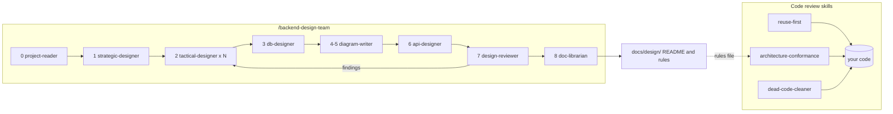

# Backend skills pack

A small, audited set of Claude Code skills and agents for backend work: designing a backend from a prototype, reviewing code against its architecture, cleaning dead code, and the habits around it (reuse before writing, test first, verify before claiming done).

**The problem it solves: token cost and speed.** Claude Code lists the name and description of every installed skill in every session. With about 415 skills installed, that listing costs about **36,500 tokens** before you type anything, and Claude has to pick from 415 options. This pack lists **14 skills for about 1,018 tokens** (plus 534 for its 8 agents). Four heavy skills are manual-only, so they cost nothing until you call them. The numbers are in [TOKEN-REPORT.md](TOKEN-REPORT.md).

## Quick start

1. **See what would change** (dry run, writes nothing):
   ```
   bash backend-skills-pack/scripts/install.sh --project /path/to/your/project
   ```
   On Windows PowerShell: `powershell -ExecutionPolicy Bypass -File backend-skills-pack\scripts\install.ps1 -Project C:\path\to\your\project` (same options: `-User`, `-Apply`).
   Each line says `NEW`, `SAME` or `CHANGED`. Use `--user` instead to install into `~/.claude/` for every project.
2. **Install** by adding `--apply`. Skills are copied, never symlinked, into `<project>/.claude/skills/`, and agents into `<project>/.claude/agents/`. A copy that already exists and differs is moved to `.claude/.backend-skills-pack-backup/<time>/` first. Nothing is downloaded, and no hook or setting is changed.
3. **Start a new session** (or `/clear`) in that project.
4. **Use them.** Auto skills start by themselves when your request matches their description; you can also call any skill as `/<name>`. Manual-only skills run only when you type `/<name>`.

| Call | What happens |
|---|---|
| `/backend-design-team start prototype/` | Designs a backend from a prototype in 9 phases (manual) |
| `/backend-design-team resume` | Continues from `docs/design/00-state.md` |
| `/dead-code-cleaner report src` · `/dead-code-cleaner apply` | Dead and duplicate code report, then safe deletions (manual) |
| `/skill-security-audit <folder or repo-url@sha>` | Audits a third-party skill before it enters the pack (manual) |
| `/skill-creator` | Writes or improves a skill, with evals (manual) |
| "Check src/ against ARCHITECTURE.md" | architecture-conformance starts by itself |
| "I need a slug helper, does one exist?" | reuse-first starts by itself |

Undo: delete the names listed in `.claude/.backend-skills-pack-installed.txt` and move any backup folders back.

To keep your other ~400 skills out of a session without moving anything, start Claude Code in that project with `claude --setting-sources project`. That and a permanent option are in [TOKEN-REPORT.md](TOKEN-REPORT.md#proposal-use-only-this-pack-not-done-your-decision). The `python -I scripts/...` and `bash scripts/...` commands below run from inside `backend-skills-pack/`.

## The skills

Each section gives what the skill does, its hard rules, when it runs, its model, its source and audit verdict, and its description cost in tokens. "Auto" means Claude may start it by itself; "manual" means only `/name` starts it. Model aliases are explained in [The model policy](#the-model-policy).

### Review and code-health skills

**reuse-first**: Before you write a helper, utility or dependency, it finds what already exists and returns one verdict: REUSE, ADD or WRITE.
- Read-only: it never installs or edits; only package *info* commands are allowed.
- Search order: this repo, then the standard library, then installed packages, then at most 2 libraries, compared in a table.
- It stops at the first real fit (behaviour, not only the name), and says which channel it could not check.
- Auto · haiku (search and listing only, in a forked Explore subagent) · adapted from search-first (ECC, MIT), SAFE · 71 tokens.

**architecture-conformance**: Checks code (a diff, a path or the whole repo) against the architecture rules *you* wrote, and reports violations.
- Rules come only from a file (`docs/ddd/service-design-rules.md`, `ARCHITECTURE.md`, `CLAUDE.md` or a named file). No file means it stops; it never invents "typical" rules.
- Each rule becomes a check: your repo's own tool first, then `scripts/check.py`, then judgement on a forked opus subagent.
- Every rule appears once as PASS, FAIL or NOT CHECKED; it writes only `docs/reviews/`.
- Auto · sonnet (checks are script-driven; judgement goes to opus) · mine · 80 tokens.

**dead-code-cleaner**: Finds unused and duplicated code with your repo's own tools (or stdlib fallbacks), classifies each candidate, and can delete the safe ones.
- Classes: SAFE-TO-DELETE (zero references of any kind, private), NEEDS-HUMAN, KEEP (dynamic use, DI, routes, ORM, public exports and more).
- It never installs a tool; apply mode needs a clean tree, a passing build and passing tests.
- Deletions run in batches of 10 or fewer, each tested and committed on `cleanup/<date>`. It never pushes, rebases or amends.
- Manual · sonnet (tool-driven; doubtful cases go to a human, not a bigger model) · mine · 67 tokens.

### Habits

**test-driven-development**: Red, green, refactor for every feature, bug fix or behaviour change.
- No production code without a failing test first; code written before its test is deleted.
- Watch the test fail for the right reason, then pass; then run the **whole** suite.
- Least code to pass; refactor only when green.
- Auto · sonnet (the loop is routine coding work) · adapted from superpowers (MIT), SAFE · 72 tokens.

**verification-before-completion**: Evidence before claims. Before saying "done", "fixed" or "passing", run the command that proves it and read the output.
- No completion claim without a fresh run in the same message.
- An agent's "success" is checked against the diff.
- No "should work" or "probably".
- Auto · sonnet (running a command and reading its output is routine work) · adopted from superpowers (MIT), SAFE (description reworded) · 64 tokens.

**dispatching-parallel-agents**: Splits independent tasks across parallel subagents and checks the combined result.
- One agent per independent domain, all started in one message.
- Each prompt is self-contained and names a hand-off file; each reply is 300 words or fewer.
- Afterwards: check for conflicts in the diff, run the full suite, spot-check one change.
- Auto · sonnet (splitting work and checking results is routine coordination) · adapted from superpowers (MIT), SAFE · 79 tokens.

**model-router**: Says which model alias a task needs and how to switch to it, and builds the model column of this README.
- Aliases only (haiku, sonnet, opus, fable), never version numbers.
- Use a script or haiku first; escalate only for judgement, never for size.
- Split mixed tasks: the mechanical part goes to haiku or sonnet, the judgement part to opus.
- Auto · haiku (a table lookup plus a script) · mine · 78 tokens.

### Pack maintenance

**skill-security-audit**: Audits a third-party skill or plugin without running it, and gives a verdict with `file:line` evidence.
- Never run, install, enable or import what it audits; the only programs are git (to pin) and `scan.py`.
- Every source is pinned at a SHA (or a tree hash) in quarantine; a new SHA means a new audit.
- Verdicts: SAFE, SAFE-WITH-CHANGES (with exact edits) or REJECT.
- Manual · opus (a wrong SAFE is expensive) · mine · 73 tokens.

**skill-creator**: Writes a new skill or improves one, runs eval prompts with and without it, and tunes its description.
- Its scripts start nested `claude -p` runs, which are billed, and write temporary files in `.claude/commands/`.
- Upstream body kept (481 lines upstream, 484 with the pack's Model and Source lines): the one accepted exception to the 150-line rule.
- Pack change: the eval viewer no longer kills other processes on its port.
- Manual · opus (writing and judging a skill is design work) · adopted from anthropics/skills (Apache-2.0), SAFE-WITH-CHANGES · 57 tokens.

### The backend design team (one orchestrator, 8 phase skills, 8 agents)

**backend-design-team** (the orchestrator): runs phases 0 to 8 on any prototype, with gates, checkpoints and a resumable state file.
- `project-profile.md` is the only source of project facts; nothing about stack, store or style is assumed.
- Every hand-off is a file with Inputs, Decisions and Open questions; worker replies are 300 words or fewer.
- A phase passes only when `design_check.py` exits 0, no MUST rule fails, and its files exist.
- It asks questions only in phase 0; review runs at most 2 fix loops; it commits only that phase's files, by path.
- Manual · sonnet (routes work; judgement happens in the workers) · mine · 73 tokens.

The 8 phase skills share these rules: never invent a business rule (it goes to Open questions), cite a source for every decision, files of 300 lines or fewer, and a self-check against the rulebook ids in each reply. They are auto skills, because an agent can preload only auto skills, but in practice the orchestrator's agents run them.

| Skill | What it does (phase) | Extra hard rules | Model, why | Source, verdict | Tokens |
|---|---|---|---|---|---|
| project-understanding | Reads the prototype and repo; writes the profile and brief (0) | A field is `detected: <file>` or `missing`, never a popular guess; every REQ cites a source | sonnet: extraction with care | adapted from codebase-onboarding (ECC, MIT), SAFE | 69 |
| ddd-strategic | Subdomains, bounded contexts, context map, ubiquitous language (1) | Every REQ is owned by exactly one context; never one context per table | opus: the costliest choice to get wrong | mine | 70 |
| ddd-tactical | Aggregates, invariants, commands, events, policies, read models, for one context (2) | Each command changes one aggregate and has one trigger (actor or policy) | opus: design judgement | mine | 74 |
| db-design-erd | Tables per module, constraints, indexes, outbox and inbox; then the ERD (3, 4) | No foreign key across modules; every invariant is enforced or listed with a reason | opus for 3, sonnet for the ERD | adapted from data-modeling-discipline (backend-design, MIT), SAFE | 73 |
| design-diagrams | Use cases, module diagram, key flows, context map (5) | Draws only what the files state, in the profile's format | sonnet: no new decisions | mine | 66 |
| api-endpoints | Operations, errors, idempotency, pagination, contract file (6) | Policy-triggered commands are never exposed; every command states its idempotency | opus: it is a contract | adapted from api-design + contract-first (ECC, MIT), SAFE | 75 |
| design-review-fix | Independent review against the prototype, the brief and the rules (7) | Read-only; every finding has a concrete case, `file:line` and the smallest fix | fable: the only check that did not write the design | adapted from ponytail-audit (MIT), SAFE-WITH-CHANGES | 74 |
| design-docs-organizer | Moves files into folders, fixes links, writes the README index (8) | A script moves and checks; content is never edited, which a hash check proves | haiku: a script does the work | adapted from living-docs-governance (ECC, MIT), SAFE | 68 |

## How the pieces fit



The design team writes the rules and the design. architecture-conformance later checks code against those rules. reuse-first and dead-code-cleaner keep the code lean between design and review.

| # | Agent (skill it preloads) | Writes (in `docs/design/` by default) |
|---|---|---|
| 0 | project-reader (project-understanding) | `project-profile.md`, `00-project-brief.md` |
| 1 | strategic-designer (ddd-strategic) | `01-strategic.md` |
| 2 | tactical-designer, one per context, in parallel (ddd-tactical) | `02-tactical-<context>.md` |
| 3 | db-designer (db-design-erd) | `03-db-design.md` |
| 4 | diagram-writer (db-design-erd, ERD part) | `04-erd.md` |
| 5 | diagram-writer (design-diagrams) | `05-diagrams.md` |
| 6 | api-designer (api-endpoints) | `06-api.md` (+ a contract file if the profile asks) |
| 7 | design-reviewer (design-review-fix), then the authors fix | `07-review.md` only (the orchestrator writes `07-lint.md` and `07-fixes-loop<k>.md`) |
| 8 | doc-librarian (design-docs-organizer) | `README.md`, final folders |

The orchestrator also keeps `00-state.md` (phase table, gates, open questions), so `/backend-design-team resume` works in a new session.

**What you give it:** a prototype (code, UI screens or mockups, a spec, a README, or plain text) and, if you have one, a rules file. Phase 0 drafts `project-profile.md`: the language, database, API style, diagram format, naming and id conventions, and output folder. Each field is either detected from a file or marked `missing`, and the orchestrator asks you about every missing field before any design starts. A filled-in example is [examples/example-profile.md](examples/example-profile.md). No skill reads it; it is only there to show you the shape.

## The model policy

From [model-router](skills/model-router/SKILL.md). Aliases only; they always point to the current model.

| Work | Alias | Why |
|---|---|---|
| Search, listing, summaries, triage, log reading | haiku | No judgement: speed and cost matter most |
| Routine edits, mechanical fixes, diagrams, tool-driven checks | sonnet | Reliable changes at moderate cost |
| Design, DDD modelling, security, reviewing others' work | opus | A wrong call costs more than the tokens |
| The hardest work, or what sonnet and opus both failed | fable | Highest capability and cost; use rarely |
| Plan with judgement, then build | opusplan | opus in plan mode, sonnet for implementation |

A skill's `model:` applies only to the turn the skill runs in, and the session model resumes on your next prompt. An agent's `model:` applies to every run of that agent.

## The token budget

From [TOKEN-REPORT.md](TOKEN-REPORT.md) (characters / 4):

| Set | ~Tokens listed every session |
|---|---|
| Everything installed today (415 skills) | 36,472 |
| This pack, auto skills (14) | 1,018 (97.2% less) |
| This pack, auto skills + 8 agents | 1,553 (95.7% less) |
| Manual-only skills (4) | 0 until called |

## Security policy

A skill enters the pack only like this:
1. **Quarantine at a pinned SHA.** Clone into `_quarantine/<name>/` with hooks off and no submodules, check out a fixed SHA, and never pull. Nothing in quarantine is run, installed or enabled.
2. **Audit** with `/skill-security-audit`: scan, read every file, and record a verdict with `file:line` evidence in [AUDIT.md](AUDIT.md).
3. **Only SAFE or SAFE-WITH-CHANGES** enters, with the changes applied, its licence file and a Source line (repo + SHA).
4. **Gate:** `python -I scripts/scan.py` must report 0 unwaived REJECT-class hits. A waiver is one reviewed line in [tests/scan-waivers.tsv](tests/scan-waivers.tsv), with its reason.

**Forbidden** without your written approval: hooks; always-on behaviour ("use on any task"); network calls; reading credentials, `.env` or session transcripts; load-time shell injection; bare `Bash` in `allowed-tools`; side effects (delete, git, writing outside `docs/`) on a skill Claude can start by itself.

## How to add or change a skill

1. Write or change it with `/skill-creator`. Keep the description at 45 words or fewer (what, when, when not) and the body at 150 lines or fewer. Details go in `references/`, and deterministic work goes in a stdlib script in `scripts/`.
2. Set `model:` and start the body with `Model: <alias>, because <why>.` Add `disable-model-invocation: true` if it has side effects.
3. Third-party? Audit it first (see [Security policy](#security-policy)) and add it to `PROVENANCE` in `scripts/pack_report.py`.
4. Add 2 should-trigger prompts and 1 should-not prompt to [tests/triggers.json](tests/triggers.json).
5. Run the checks:
   ```
   python -I scripts/check_skill.py           # name = folder, <= 45 words, <= 150 lines, model, stdlib-only scripts
   python -I scripts/scan.py                  # security gate
   python -I scripts/pack_report.py           # MANIFEST.json + TOKEN-REPORT.md
   python -I scripts/verify-pack.py           # full pack verification (checks A-K); exit 0 = no FAIL
   bash scripts/install.sh --project <tmp> --apply
   python -I tests/run_triggers.py <tmp> --only <name>   # billed: starts claude -p runs
   ```

Use your Python 3 command (`python`, `python3` or a versioned one) with `-I`. Every script uses only the standard library.

## Credits and licences

Full texts: [THIRD-PARTY-NOTICES.md](THIRD-PARTY-NOTICES.md). The per-skill table, with SHAs, is in [MANIFEST.json](MANIFEST.json).

- **skill-creator**: github.com/anthropics/skills @ `1780c5e`, Apache-2.0 ([LICENSE.txt](skills/skill-creator/LICENSE.txt)).
- **verification-before-completion, test-driven-development, dispatching-parallel-agents**: github.com/obra/superpowers @ `22f0b46`, MIT, (c) 2025 Jesse Vincent.
- **design-review-fix** adapts ponytail-audit: github.com/DietrichGebert/ponytail @ `96608e0`, MIT, (c) 2026 DietrichGebert.
- **db-design-erd** adapts data-modeling-discipline: backend-design plugin v0.2.0, MIT, (c) sheitabrk and contributors.
- **reuse-first, project-understanding, api-endpoints, design-docs-organizer** adapt ECC v2.2.3 skills (github.com/affaan-m/ECC, MIT, Affaan Mustafa).
- All other skills, the agents and the scripts are yours.

## Known limits

- **ECC and backend-design sources have no pinned SHA.** They were audited from installed copies, and ECC's licence text is not on disk yet (THIRD-PARTY-NOTICES lists it as "to add").
- **Your own skills have no licence file.** Choose one before you share the pack.
- **Trigger tests are model-dependent.** They ran on sonnet in a project-only session (see [tests/results/](tests/results/)). Other models may trigger differently.
- **Token counts are estimates** (characters / 4), not tokenizer counts. That manual-only descriptions stay out of the listing comes from the docs, and the test in TOKEN-REPORT.md checks it.
- **skill-creator** needs PyYAML for `quick_validate.py`, and its eval viewer serves on 127.0.0.1 (use `--static` to avoid that).
- **The 8 phase skills are auto skills** (an agent cannot preload a manual-only skill), so their 569 tokens are listed even when you are not designing.
- **Windows:** use `python` or `python3` with `-I`. `install.sh` needs Git Bash (or any bash with `tar` and `diff`); `install.ps1` needs only Windows PowerShell 5.1.
- **Not included:** a code-review skill (ponytail-review overlaps the bundled `/code-review`) and architecture-decision-records.
