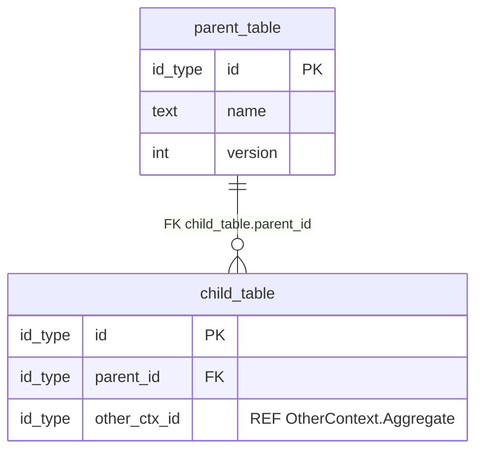

# ERD notation per diagram format

Use only the format named in the profile's `diagram_format`. Never mix formats in one file.

## Mermaid (`erDiagram`)

````markdown

````

Mermaid has no dotted relationship in `erDiagram` that means "not a foreign key". Draw cross-module references in the **overview** as a `flowchart` between module subgraphs, with dotted `-.->|ref|` edges. In module diagrams, mark the column with the comment `"REF <Context>.<Aggregate>"`.

## PlantUML (IE notation)

````markdown
```plantuml
@startuml
entity "parent_table" as parent_table {
  * id : <type> <<PK>>
  --
  * name : <type>
}
entity "child_table" as child_table {
  * id : <type> <<PK>>
  --
  * parent_id : <type> <<FK>>
  other_ctx_id : <type> <<REF OtherContext.Aggregate>>
}
parent_table ||--o{ child_table
package "OtherModule" { entity "other_table" as other_table }
child_table ..> other_table : ref
@enduml
```
````

Cross-module references use the dotted `..>` arrow labelled `ref`. Foreign keys use the crow's-foot connectors (`||--o{`, `||--||`, `}o--o{`).

## Other formats

Use the format's own entity and relationship notation. Keep three distinct markers: primary key, in-module foreign key, and cross-module reference. State the legend in one line above the diagram.
