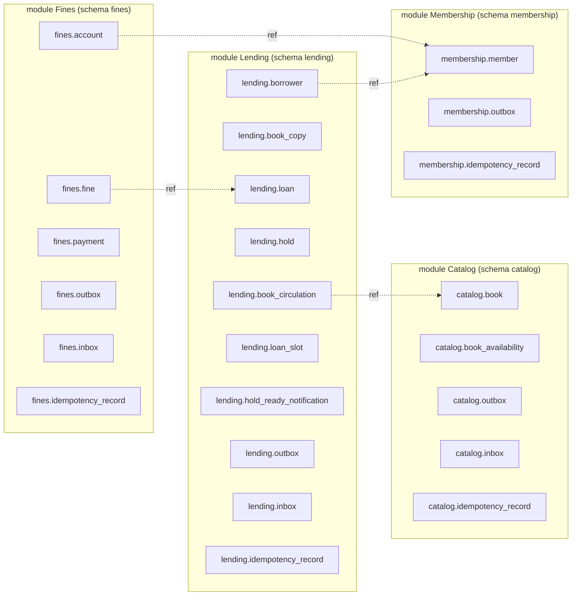
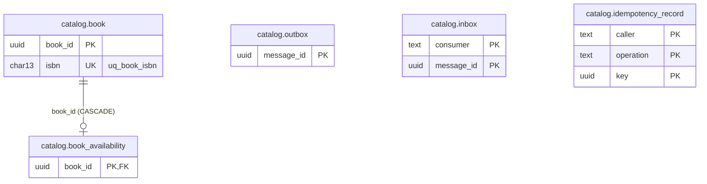
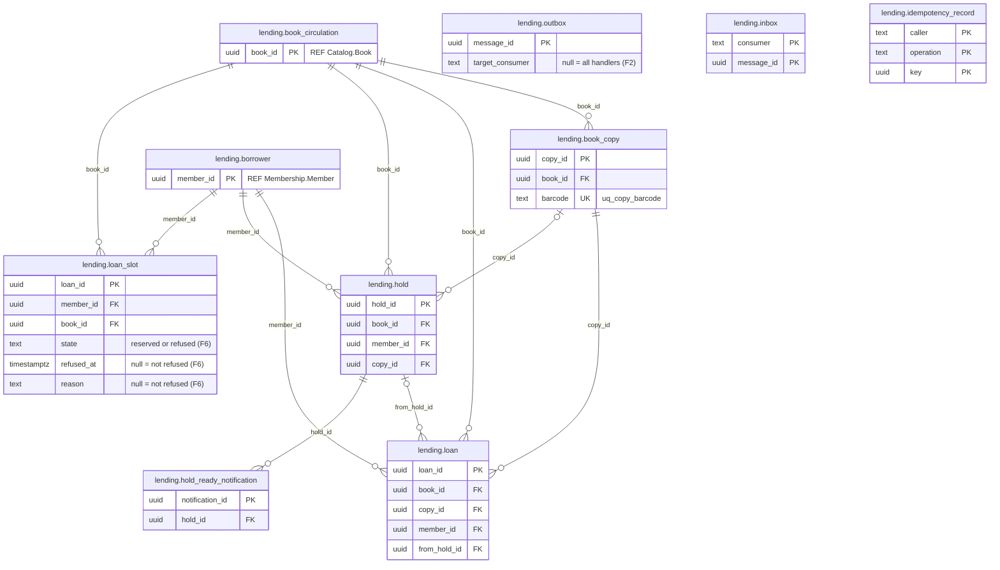
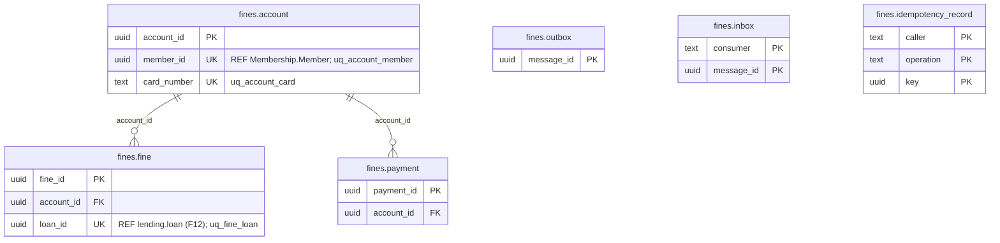
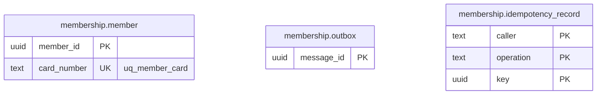

# 04 ERD

## Inputs
- docs/design/project-profile.md: diagram_format = mermaid.
- docs/design/03-db-design.md (Catalog, Membership, Modules table), 03-db-design-lending.md, 03-db-design-fines.md: tables, keys, FKs, REFs.

## Decisions
- D4-1 One `erDiagram` per module (4) plus one overview `flowchart` (1). Every table in the 03 Modules table appears by its exact physical name (24 tables: catalog 5, lending 10, fines 6, membership 3).
- D4-2 Table names contain a dot, so they are written as quoted entity names, for example `"catalog.book"`. This needs a Mermaid version that accepts quoted entity names (10.x or later).
- D4-3 Each table lists only its key columns (PK, FK, REF, and UK where 03 declares a plain unique key on that column). The 300-line limit (DOC-01) rules out listing every column. Types, nulls, defaults and checks stay in 03. The exceptions are the columns that 03 added in the fixes F2 and F6 (`lending.outbox.target_consumer`, `lending.loan_slot.state`, `refused_at`, `reason`), which are drawn so the fix is visible.
- D4-4 Mermaid has no REF key marker. A REF column is drawn with the comment `REF <Context>.<Aggregate>` and no relationship line inside the module diagrams. Cross-module REFs are drawn only in the overview, as dotted lines labelled `ref`.
- D4-5 Relationship lines come only from the FK lines in 03. Every FK is ON DELETE RESTRICT except `catalog.book_availability.book_id` (CASCADE), as in 03.
- D4-6 Each `idempotency_record` table is drawn with its composite PK (`caller`, `operation`, `key`) and no relationship line, because 03 lists no FK or REF on it (D3-17).
- Fixed F2, F3, F6: F2 adds `lending.outbox.target_consumer` (03-db-design-lending.md D3-L5); F3 adds `catalog.idempotency_record`, `lending.idempotency_record`, `fines.idempotency_record` and `membership.idempotency_record` (03 D3-17); F6 adds `state`, `refused_at` and `reason` to `lending.loan_slot` (03-db-design-lending.md D3-L3).

## Open questions
| Id | Question | Why it matters | Proposed default |
|---|---|---|---|
| EQ-1 | Mermaid `erDiagram` cannot show partial unique indexes, CHECKs or ON DELETE actions. Are notes enough? | Diagram detail is lower than 03. | Keep 03 as the source for these; this file shows keys and relationships only. |
| EQ-2 | 03 lists no FK on `catalog.outbox`, `catalog.inbox`, the four `idempotency_record` tables, `lending.outbox`, `lending.inbox`, `fines.outbox`, `fines.inbox` and `membership.outbox`, and no REF for `aggregate_id`. Is that final? | These tables are drawn without relationship lines. | Yes, as in 03. |

## Overview: modules and cross-module REFs
Drawn from the 03 Modules table and the REF lines in 03.

Legend: dotted `ref` lines are plain id columns with no foreign key (03: REF lines).

## Catalog
Drawn from 03-db-design.md, tables in module Catalog.

## Lending
Drawn from 03-db-design-lending.md.

## Fines
Drawn from 03-db-design-fines.md.

## Membership
Drawn from 03-db-design.md, tables in module Membership.

Note: `uq_member_email` is on `lower(email)`, an expression, so it is not drawn as a column key (see 03).
