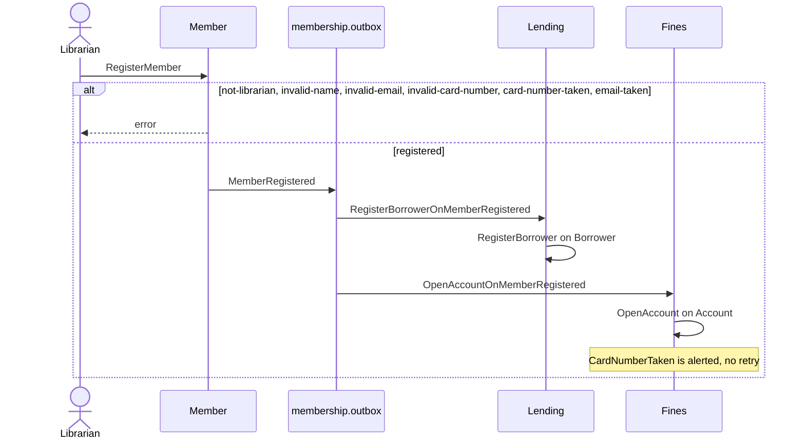
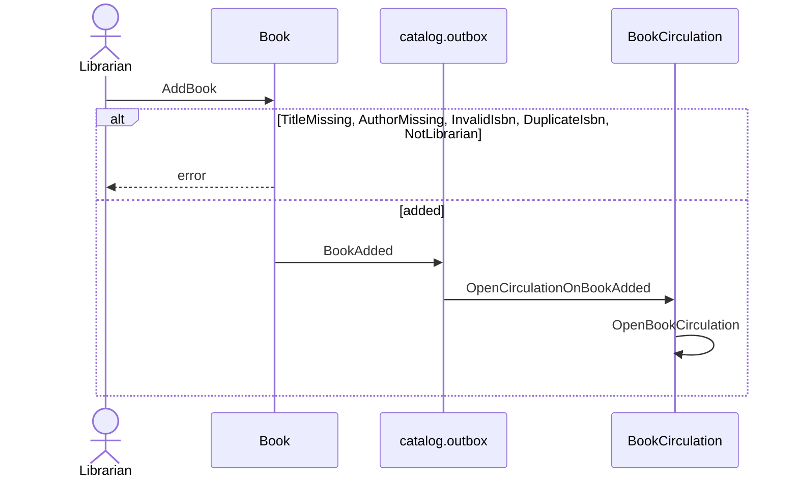
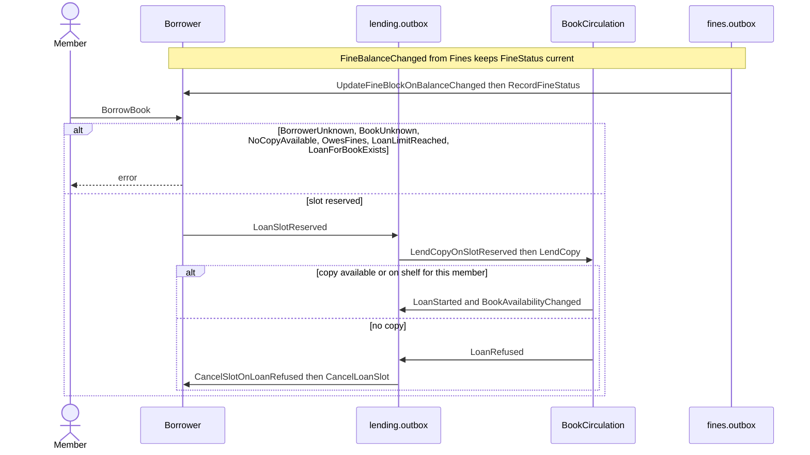
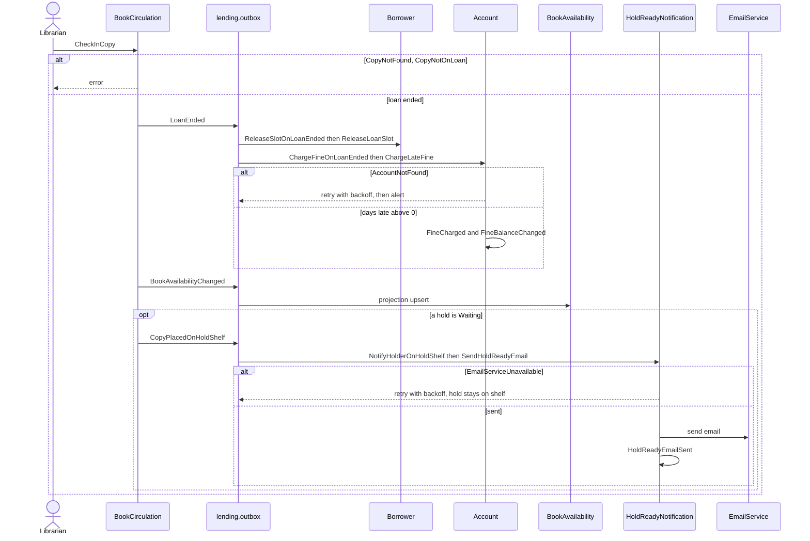
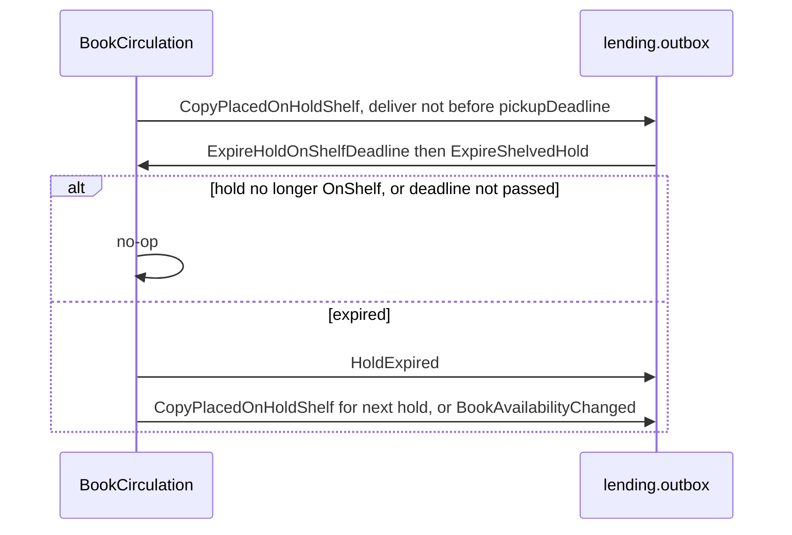
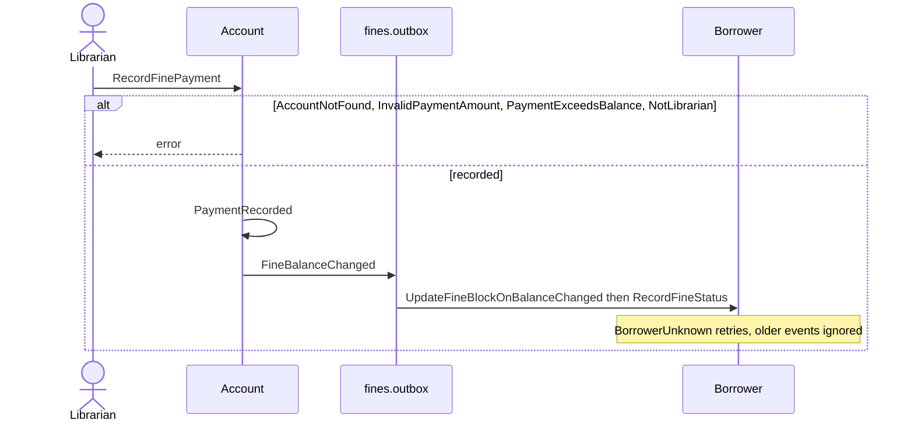

# 05 Diagrams: key flows

Part of [05-diagrams.md](05-diagrams.md).

## Inputs
- docs/design/project-profile.md: diagram_format = mermaid; events_messaging = in-process domain events plus a transactional outbox per module, no broker.
- docs/design/01-strategic.md: Context map.
- docs/design/02-tactical-catalog.md, 02-tactical-lending.md, 02-tactical-fines.md, 02-tactical-membership.md: Commands, Domain events, Policies, Queries and read models.

## Decisions
- D5-6 Flows drawn: member registration, add book, borrow, check in with hold, hold shelf expiry, fine payment. Each crosses a context or sits behind a core-subdomain REQ (Circulation).
- D5-7 Event names in flows use the `Emits` and `Consumers` columns of 02. Outbox is shown as a participant per emitting module, per the profile.
- Fixed L1: 05-diagrams.md was 311 lines (over 300). Key flows moved here unchanged; the main file links to this part.

## Open questions
| Id | Question | Proposed default |
|---|---|---|
| DG-3 | 02 names no operation for the call to the email service, only SendHoldReadyEmail. | Drawn as a participant EmailService with a "send email" message (01 D1-8). |

## Key flows

### FLOW-1 RegisterMember
Drawn from: 02-tactical-membership.md Commands, Domain events; 02-tactical-lending.md and 02-tactical-fines.md Policies; 01 Context map.

### FLOW-2 AddBook
Drawn from: 02-tactical-catalog.md Commands, Domain events; 02-tactical-lending.md Policies.

### FLOW-3 BorrowBook
Drawn from: 02-tactical-lending.md Commands, Domain events, Policies, Aggregates (REQ-5 to REQ-10, Circulation core subdomain).

### FLOW-4 CheckInCopy
Drawn from: 02-tactical-lending.md Commands, Domain events, Policies; 02-tactical-fines.md Policies; 02-tactical-catalog.md Queries and read models (REQ-16, REQ-17, REQ-19, REQ-20, REQ-21).

### FLOW-5 ExpireShelvedHold
Drawn from: 02-tactical-lending.md Policies, Commands, Decisions D2-8 (REQ-17).

### FLOW-6 RecordFinePayment
Drawn from: 02-tactical-fines.md Commands, Domain events; 02-tactical-lending.md Policies (REQ-9, REQ-23).

