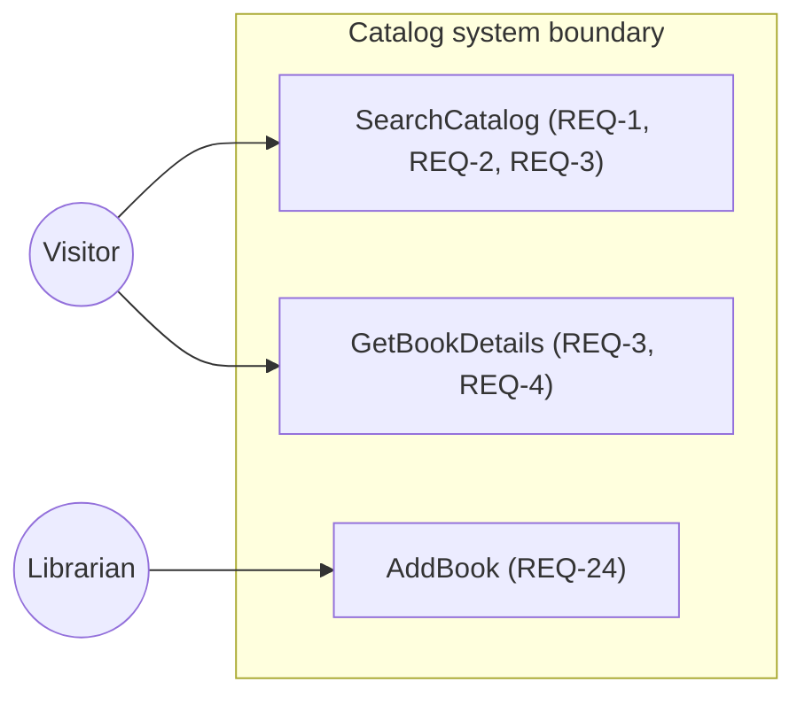
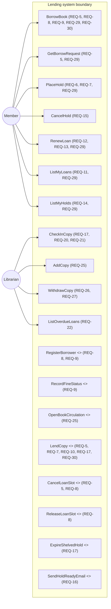
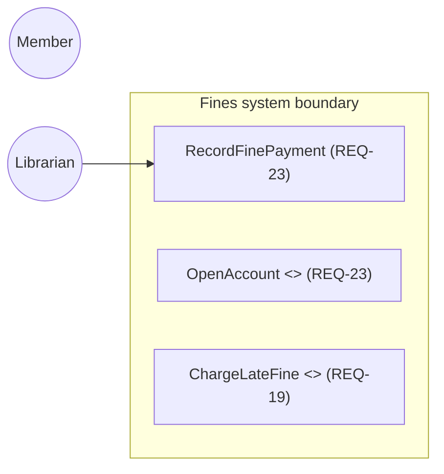
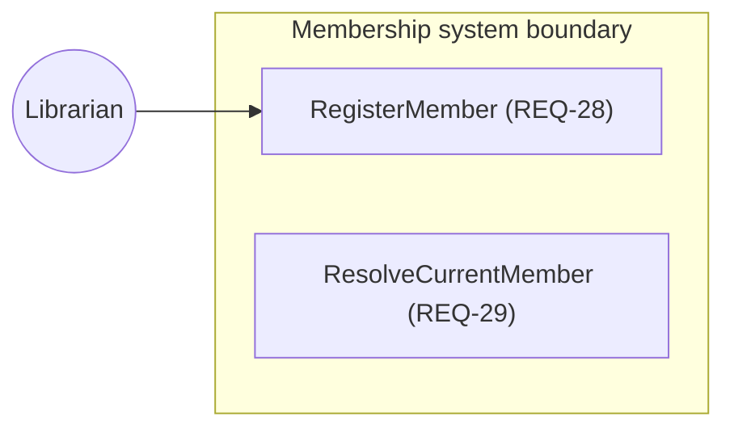
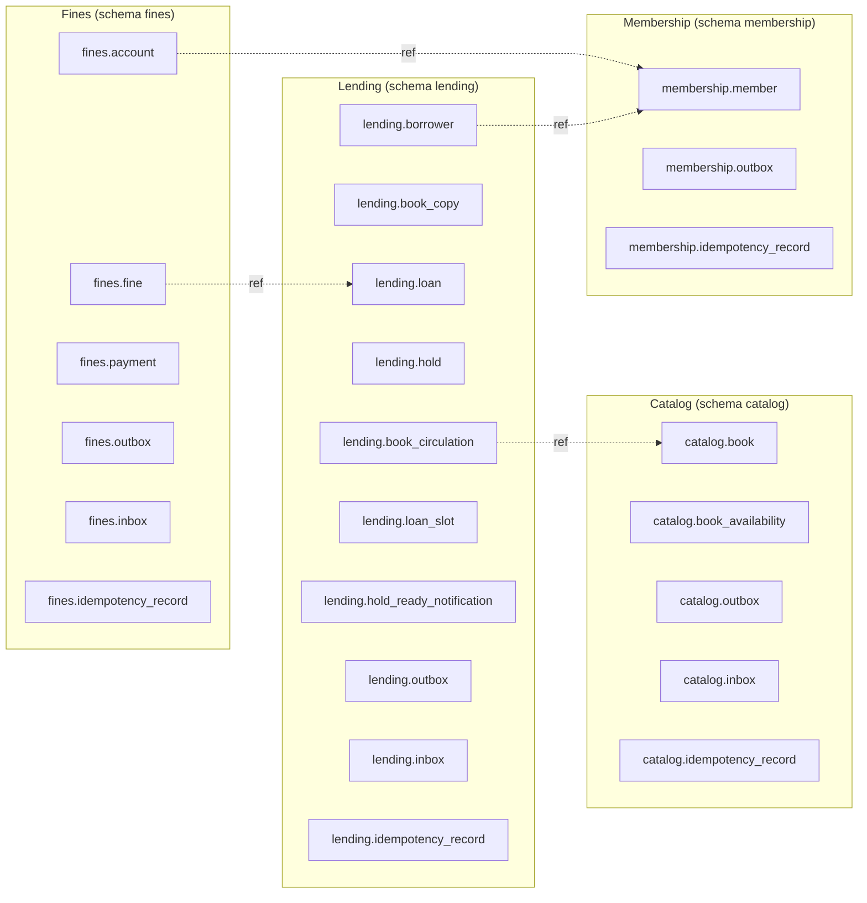
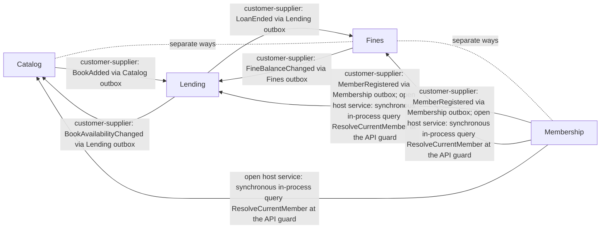

# 05 Diagrams

Key flows are in [05-diagrams-flows.md](05-diagrams-flows.md).

## Inputs
- docs/design/project-profile.md: diagram_format = mermaid; events_messaging = in-process domain events plus a transactional outbox per module, no broker.
- docs/design/00-project-brief.md: Actors (Visitor, Member, Librarian, System).
- docs/design/01-strategic.md: Context map, Published language.
- docs/design/02-tactical-catalog.md, 02-tactical-lending.md, 02-tactical-fines.md, 02-tactical-membership.md: Commands, Domain events, Policies, Queries and read models.
- docs/design/03-db-design.md: Modules table. 03-db-design-lending.md and 03-db-design-fines.md: only the `REF` lines.

## Decisions
- D5-1 Mermaid has no use-case diagram, so use cases are `flowchart LR` with actors as `((Actor))` nodes and a `subgraph` as system boundary (skill rule).
- D5-2 Policy-triggered commands carry the label `<<policy>>` and have no edge from any actor. The Policy name is shown with the command.
- D5-3 Use-case REQ labels come from the REQ column of each Commands and Queries table in 02.
- D5-4 Catalog GetBookDetails is drawn for Visitor only (Catalog D2-8, proposed; CQ-4 is open).
- D5-5 Database modules diagram shows the four `REF` lines found in 03 (lending.book_circulation, lending.borrower, fines.account, fines.fine). Inbox and outbox tables are listed as in the 03 Modules table.
- Fixed F1: CTX-map now draws Membership upstream of Catalog, Lending and Fines via open host service, synchronous in-process ResolveCurrentMember at the API guard (01 Context map, D1-10, D1-12). The Catalog/Membership "separate ways" edge is removed.
- Fixed F12: DB-modules edge `f2 -.->|ref| l3` (fines.fine.loan_id references lending.loan, as in 04-erd.md).
- Fixed F4 (loop 2): UC-Lending adds GetBorrowRequest (REQ-5, REQ-29) with a Member edge; REQ-30 added to BorrowBook and LendCopy, REQ-5 to CancelLoanSlot; DB-modules adds the four `idempotency_record` nodes (24 tables, as the 03 Modules table).
- Fixed L1: file was 311 lines (over 300). Key flows (D5-6, D5-7) moved unchanged to 05-diagrams-flows.md; this file links to it.

## Open questions
| Id | Question | Proposed default |
|---|---|---|
| DG-1 | ResolveCurrentMember (query) names no actor in 02. Which actor triggers it? | Left unlinked in UC-Membership; it is called by the API layer for every signed-in request (02 Membership D2-4). |
| DG-2 | SearchCatalog and GetBookDetails: 02 gives REQ-4 to Member in the brief but Visitor in Catalog D2-8 (CQ-4). | Drawn for Visitor, as 02 proposes. |
| DG-3 | Email service call name: see 05-diagrams-flows.md. | See 05-diagrams-flows.md. |

## Use cases

### UC-Catalog
Drawn from: 00 Actors, 02-tactical-catalog.md Commands and Queries.

### UC-Lending
Drawn from: 00 Actors, 02-tactical-lending.md Commands, Policies and Queries.

### UC-Fines
Drawn from: 00 Actors, 02-tactical-fines.md Commands, Policies and Queries.

### UC-Membership
Drawn from: 00 Actors, 02-tactical-membership.md Commands and Queries.

## Database modules

### DB-modules
Drawn from: 03-db-design.md Modules table; REF lines in 03-db-design-lending.md and 03-db-design-fines.md.

## Key flows
See [05-diagrams-flows.md](05-diagrams-flows.md): FLOW-1 RegisterMember, FLOW-2 AddBook, FLOW-3 BorrowBook, FLOW-4 CheckInCopy, FLOW-5 ExpireShelvedHold, FLOW-6 RecordFinePayment.

## Context map

### CTX-map
Drawn from: 01-strategic.md Context map.

