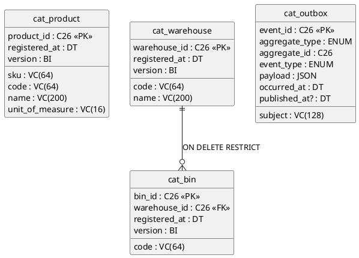
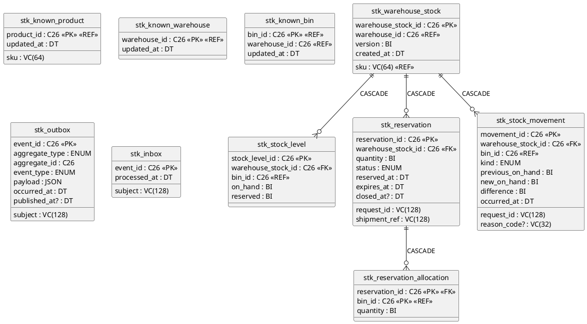
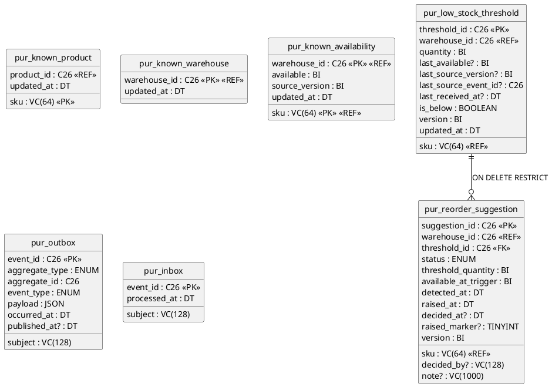

# 04 ERD

Format: PlantUML (profile `diagram_format`). Drawn from 03-db-design.md and its three parts only. Legend: `<<PK>>` primary key, `<<FK>>` foreign key inside the module (solid line), `<<REF>>` id of another context's aggregate (no FK, dotted `ref` line in the overview only). Columns marked `?` are NULL. Types are shortened: C26 is `CHAR(26)`, DT is `DATETIME(6)`, BI is `BIGINT`, VC is `VARCHAR`.

## Inputs
- docs/design/project-profile.md: diagram_format plantuml; architecture_style microservices; one shared schema `stockroom` (R1).
- docs/design/03-db-design.md (Modules table, D3-1 to D3-15), 03-db-design-catalog.md, 03-db-design-stock.md, 03-db-design-purchasing.md (Tables sections).

## Decisions
| Id | Decision | Why | Source |
|---|---|---|---|
| D4-1 | One diagram per module plus one overview. All 21 tables of 03 appear by physical name. | ERD rule in db-design-erd. | 03 Modules |
| D4-2 | Cross-module REFs are `<<REF>>` columns in the module diagrams, and dotted `ref` lines only in the overview. No relationship line crosses a module in a module diagram. | DB-01: no FK across modules. | 03 D3-1, Tables |
| D4-3 | The shared schema `stockroom` (R1 overrides DB-02) is shown as the outer frame of the overview. | Override recorded in 03 D3-1. | 03 D3-1 |
| D4-4 | `raised_marker` (generated column) and `pur_known_product.sku` (PK) are drawn as 03 states them. | Draw only what 03 says. | pur Tables |

## Open questions
- Q4-1 PlantUML entities cannot show CHECK, UNIQUE or index details. Those stay in 03. Proposed default: no action.
- Q4-2 Read-model rebuild sources (event subjects) and outbox/inbox event flow are not drawn in the ERD; they belong to the flow diagrams (phase 5). Proposed default: none.

## Overview

```plantuml
@startuml
rectangle "schema stockroom (shared, R1)" {
  package "cat (Catalog)" {
    [cat_product]
    [cat_warehouse]
    [cat_bin]
    [cat_outbox]
  }
  package "stk (Stock)" {
    [stk_warehouse_stock]
    [stk_stock_level]
    [stk_reservation]
    [stk_reservation_allocation]
    [stk_stock_movement]
    [stk_known_product]
    [stk_known_warehouse]
    [stk_known_bin]
    [stk_outbox]
    [stk_inbox]
  }
  package "pur (Purchasing)" {
    [pur_low_stock_threshold]
    [pur_reorder_suggestion]
    [pur_known_product]
    [pur_known_warehouse]
    [pur_known_availability]
    [pur_outbox]
    [pur_inbox]
  }
}
[stk_warehouse_stock] ..> [cat_product] : ref
[stk_warehouse_stock] ..> [cat_warehouse] : ref
[stk_stock_level] ..> [cat_bin] : ref
[stk_reservation_allocation] ..> [cat_bin] : ref
[stk_stock_movement] ..> [cat_bin] : ref
[stk_known_product] ..> [cat_product] : ref
[stk_known_warehouse] ..> [cat_warehouse] : ref
[stk_known_bin] ..> [cat_bin] : ref
[stk_known_bin] ..> [cat_warehouse] : ref
[pur_low_stock_threshold] ..> [cat_product] : ref
[pur_low_stock_threshold] ..> [cat_warehouse] : ref
[pur_reorder_suggestion] ..> [cat_product] : ref
[pur_reorder_suggestion] ..> [cat_warehouse] : ref
[pur_known_product] ..> [cat_product] : ref
[pur_known_warehouse] ..> [cat_warehouse] : ref
[pur_known_availability] ..> [cat_product] : ref
[pur_known_availability] ..> [cat_warehouse] : ref
@enduml
```

## Catalog (cat)

## Stock (stk)

## Purchasing (pur)

