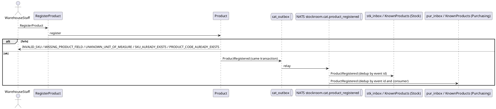
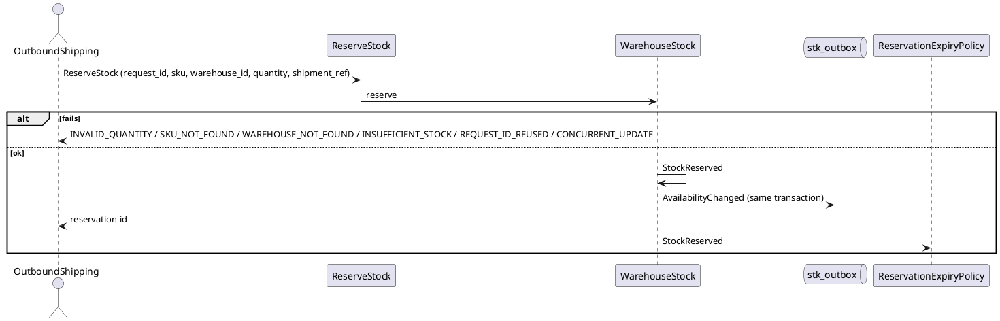
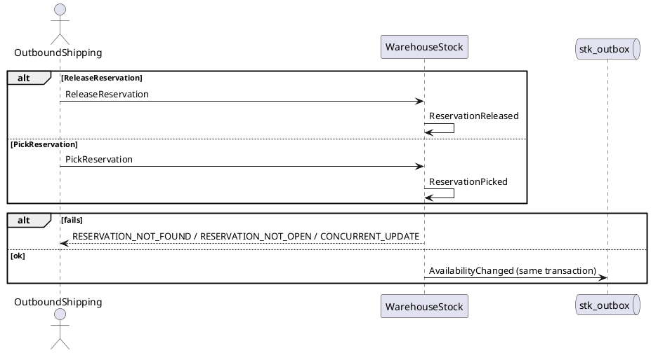
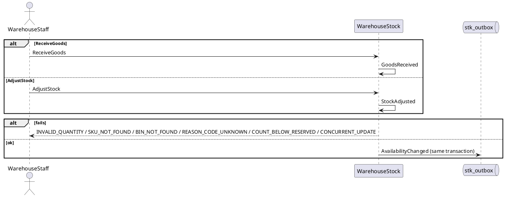
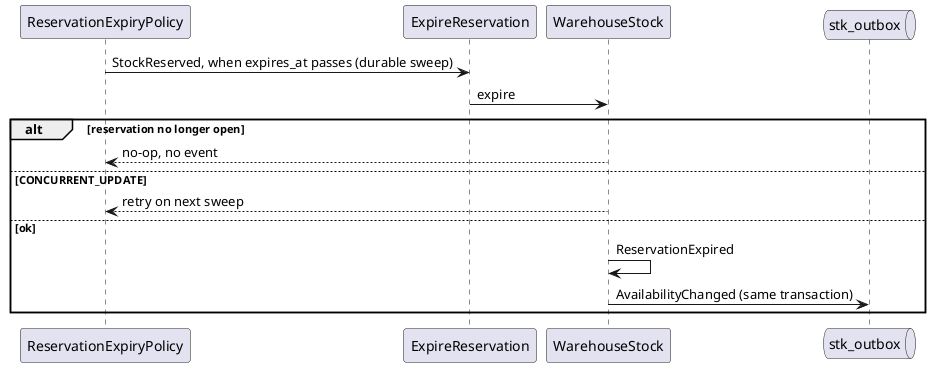
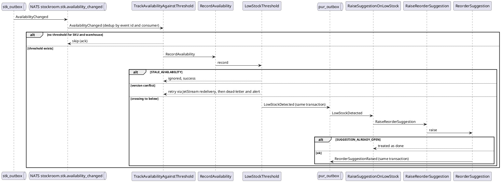
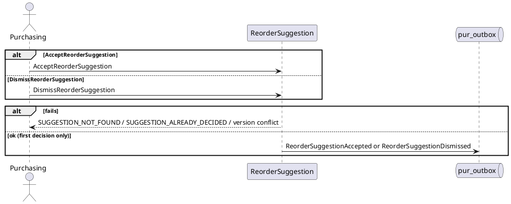

# 05 Diagrams: key flows

Part of [05-diagrams.md](05-diagrams.md). Use cases are in [05-diagrams-use-cases.md](05-diagrams-use-cases.md).

## Inputs
- project-profile.md: diagram_format = plantuml; events_messaging = outbox + NATS JetStream.
- 01-strategic.md: Context map.
- 02-tactical-catalog.md, 02-tactical-stock.md, 02-tactical-purchasing.md: Commands, Domain events, Policies, Queries and read models.

## Decisions
| Id | Decision | Why |
|---|---|---|
| D5-3 | Flows use the 02 names. The relay (NATS JetStream subject) is a participant between outbox and consumer. | Profile events_messaging. |
| D5-4 | Fixed F1: inbox dedup in FLOW-1 and FLOW-6 is per (event id, consumer). The projection step of FLOW-6 is not added; it awaits the 02 purchasing change. | Review F1. |

## Open questions
| Id | Question | Why it matters | Proposed default |
|---|---|---|---|
| Q5-3 | The 02 files give no failure branch for Catalog commands beyond Fails when. | Flow 1 shows only the failure reasons 02 lists. | As drawn. |

## Key flows

### FLOW-1 Register in Catalog and feed Stock and Purchasing
Drawn from: 02-tactical-catalog.md Commands and Domain events; 02-tactical-stock.md and 02-tactical-purchasing.md Queries and read models; 01 Context map.

RegisterWarehouse (WarehouseRegistered to Stock and Purchasing) and RegisterBin (BinRegistered to Stock) follow the same shape on subjects `stockroom.cat.warehouse_registered` and `stockroom.cat.bin_registered`.

### FLOW-2 ReserveStock
Drawn from: 02-tactical-stock.md Commands, Domain events, Policies; 01 Context map (Stock to OutboundShipping).

### FLOW-3 ReleaseReservation and PickReservation
Drawn from: 02-tactical-stock.md Commands, Domain events.

### FLOW-4 ReceiveGoods and AdjustStock
Drawn from: 02-tactical-stock.md Commands, Domain events.

REASON_CODE_UNKNOWN and COUNT_BELOW_RESERVED apply to AdjustStock only.

### FLOW-5 Reservation expiry
Drawn from: 02-tactical-stock.md Policies, Commands.

### FLOW-6 AvailabilityChanged to ReorderSuggestionRaised
Drawn from: 02-tactical-stock.md Domain events; 02-tactical-purchasing.md Commands, Domain events, Policies; 01 Context map (Stock to Purchasing).

### FLOW-7 Accept or dismiss a suggestion
Drawn from: 02-tactical-purchasing.md Commands, Domain events. Behind REQ-15 and REQ-16, which are not core; shown because the decision events are published.

