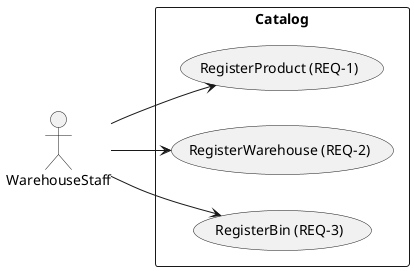
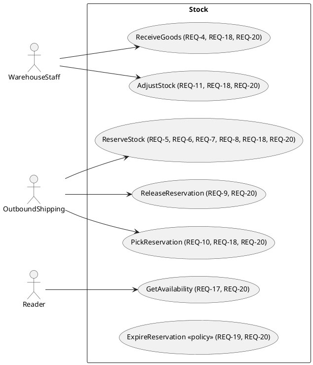
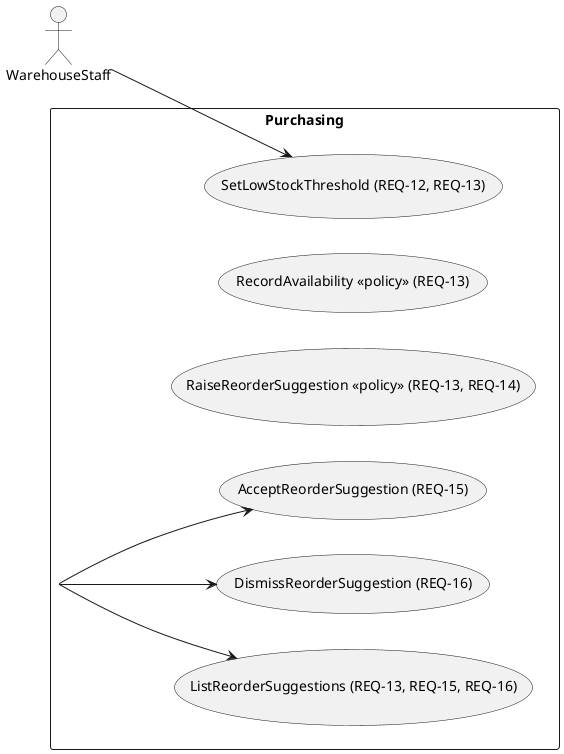

# 05 Diagrams: use cases

Part of [05-diagrams.md](05-diagrams.md). Key flows are in [05-diagrams-flows.md](05-diagrams-flows.md).

## Inputs
- project-profile.md: diagram_format = plantuml.
- 00-project-brief.md: Actors. Actor names follow the 02 triggers (WarehouseStaff, Purchasing, OutboundShipping, Reader).
- 02-tactical-catalog.md, 02-tactical-stock.md, 02-tactical-purchasing.md: Commands, Policies, Queries and read models.

## Decisions
| Id | Decision | Why |
|---|---|---|
| D5-1 | Use cases show commands and queries only; read models (KnownProducts and so on) are not use cases. | They are fed by events, not triggered by an actor. |
| D5-4 | ListReorderSuggestions is linked to the actor Purchasing. | Pur Q2-7 proposes it; the 02 file has no trigger for queries (see Q5-1). |

## Open questions
| Id | Question | Why it matters | Proposed default |
|---|---|---|---|
| Q5-1 | Who may call ListReorderSuggestions and GetAvailability? 02 gives no trigger for queries (pur Q2-7, stk Q2-11 are proposals). | The links from actor to query are not decided. | Draw as in the proposals: Purchasing and Reader. |
| Q5-2 | Which actor sets a low-stock threshold: WarehouseStaff (as in the Purchasing 02 trigger) or Purchasing (as in the brief Actors line for REQ-12)? | Changes one actor link. | WarehouseStaff, as the 02 trigger states. |

## Use cases

### UC-Catalog
Drawn from: 02-tactical-catalog.md Commands, Policies (none), Queries (none).

### UC-Stock
Drawn from: 02-tactical-stock.md Commands, Policies, Queries and read models.

### UC-Purchasing
Drawn from: 02-tactical-purchasing.md Commands, Policies, Queries and read models.

