# 05 Diagrams

## Inputs
- project-profile.md: diagram_format = plantuml; architecture_style = microservices; events_messaging = outbox + NATS JetStream.
- 00-project-brief.md: Actors. Actor names follow the 02 triggers (WarehouseStaff, Purchasing, OutboundShipping, Reader).
- 01-strategic.md: Context map, Published language.
- 02-tactical-catalog.md, 02-tactical-stock.md, 02-tactical-purchasing.md: Commands, Domain events, Policies, Queries and read models.
- 03-db-design.md: Modules table. The `REF` lines of 03-db-design-stock.md and 03-db-design-purchasing.md give the cross-module references.

## Decisions
| Id | Decision | Why |
|---|---|---|
| D5-1 | Use cases show commands and queries only; read models (KnownProducts and so on) are not use cases. | They are fed by events, not triggered by an actor. |
| D5-2 | The database overview draws one `ref` line per module pair (stk to cat, pur to cat), not one per column. | The overview is not the ERD; the columns are in 04. |
| D5-3 | Flows use the 02 names. The relay (NATS JetStream subject) is a participant between outbox and consumer. | Profile events_messaging. |
| D5-4 | ListReorderSuggestions is linked to the actor Purchasing. | Pur Q2-7 proposes it; the 02 file has no trigger for queries (see Q5-1). |

## Open questions
| Id | Question | Why it matters | Proposed default |
|---|---|---|---|
| Q5-1 | Who may call ListReorderSuggestions and GetAvailability? 02 gives no trigger for queries (pur Q2-7, stk Q2-11 are proposals). | The links from actor to query are not decided. | Draw as in the proposals: Purchasing and Reader. |
| Q5-2 | Which actor sets a low-stock threshold: WarehouseStaff (as in the Purchasing 02 trigger) or Purchasing (as in the brief Actors line for REQ-12)? | Changes one actor link. | WarehouseStaff, as the 02 trigger states. |
| Q5-3 | The 02 files give no failure branch for Catalog commands beyond Fails when. | Flow 1 shows only the failure reasons 02 lists. | As drawn. |

## Use cases

### UC-Catalog
Drawn from: 02-tactical-catalog.md Commands, Policies (none), Queries (none).
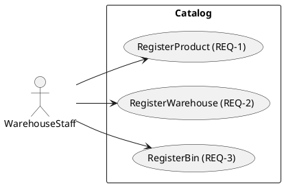

### UC-Stock
Drawn from: 02-tactical-stock.md Commands, Policies, Queries and read models.
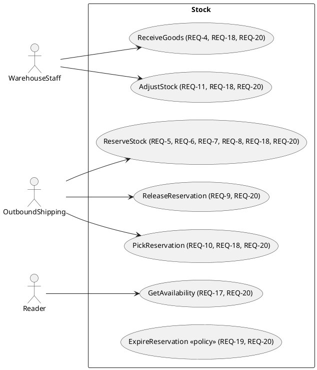

### UC-Purchasing
Drawn from: 02-tactical-purchasing.md Commands, Policies, Queries and read models.
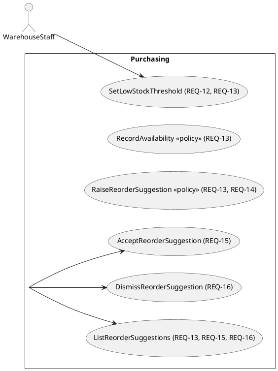

## Database modules

### DB-modules
Drawn from: 03-db-design.md Modules; REF lines of 03-db-design-stock.md and 03-db-design-purchasing.md. One shared schema `stockroom` (R1 overrides DB-02).
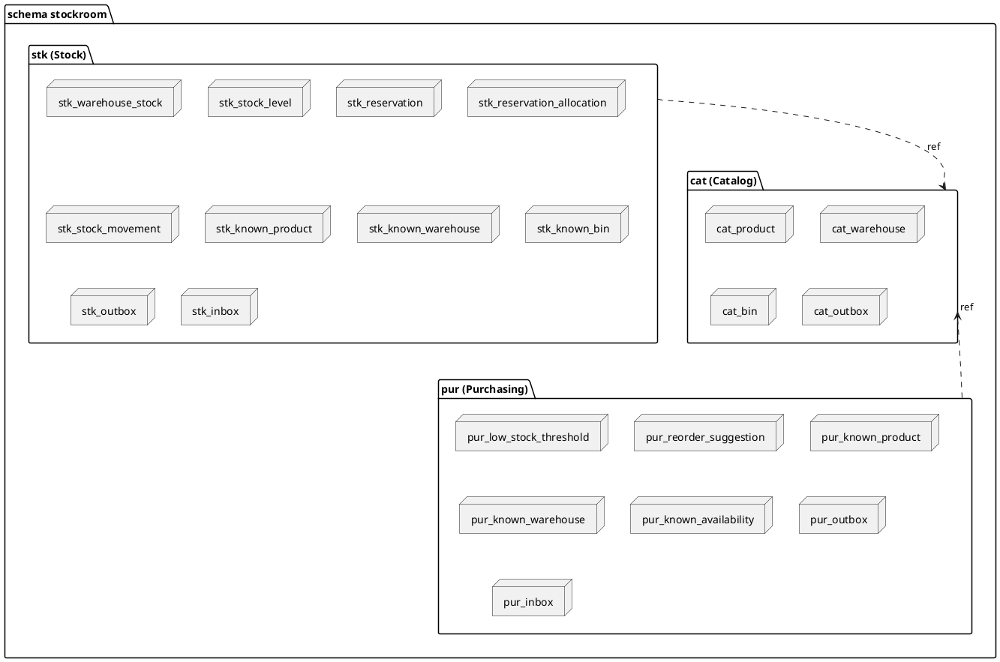

## Key flows

### FLOW-1 Register in Catalog and feed Stock and Purchasing
Drawn from: 02-tactical-catalog.md Commands and Domain events; 02-tactical-stock.md and 02-tactical-purchasing.md Queries and read models; 01 Context map.
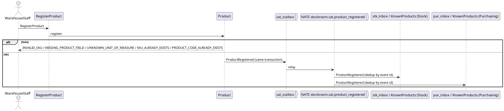
RegisterWarehouse (WarehouseRegistered to Stock and Purchasing) and RegisterBin (BinRegistered to Stock) follow the same shape on subjects `stockroom.cat.warehouse_registered` and `stockroom.cat.bin_registered`.

### FLOW-2 ReserveStock
Drawn from: 02-tactical-stock.md Commands, Domain events, Policies; 01 Context map (Stock to OutboundShipping).
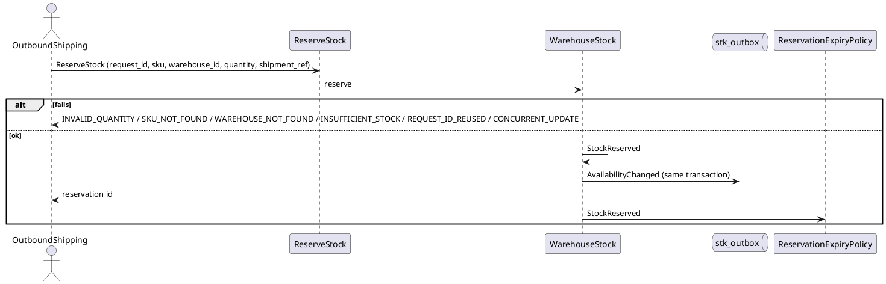

### FLOW-3 ReleaseReservation and PickReservation
Drawn from: 02-tactical-stock.md Commands, Domain events.
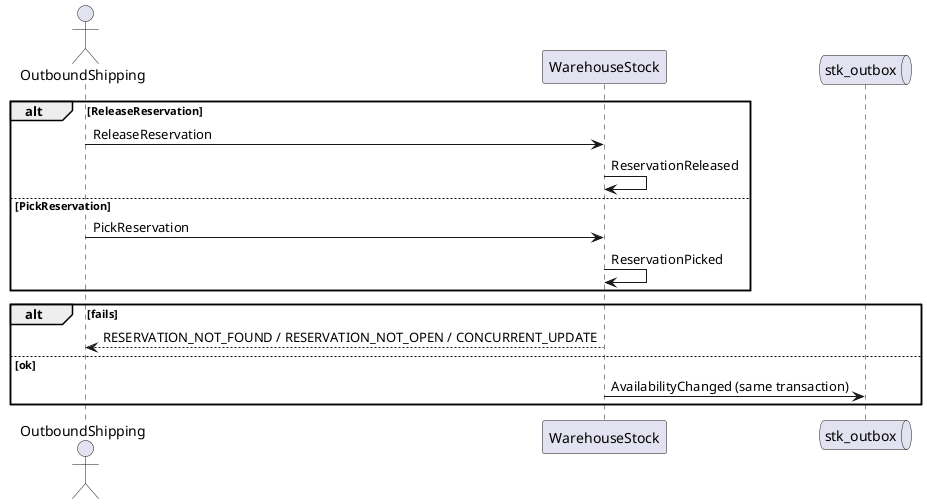

### FLOW-4 ReceiveGoods and AdjustStock
Drawn from: 02-tactical-stock.md Commands, Domain events.
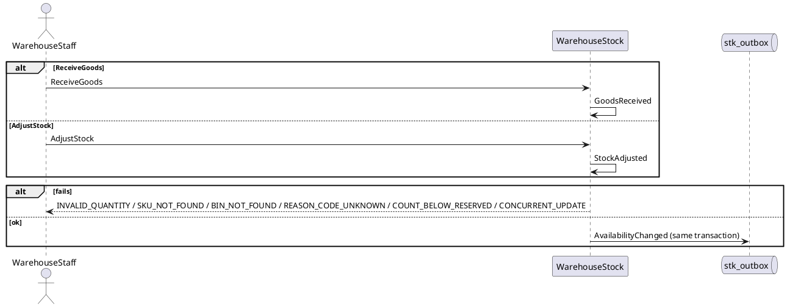
REASON_CODE_UNKNOWN and COUNT_BELOW_RESERVED apply to AdjustStock only.

### FLOW-5 Reservation expiry
Drawn from: 02-tactical-stock.md Policies, Commands.
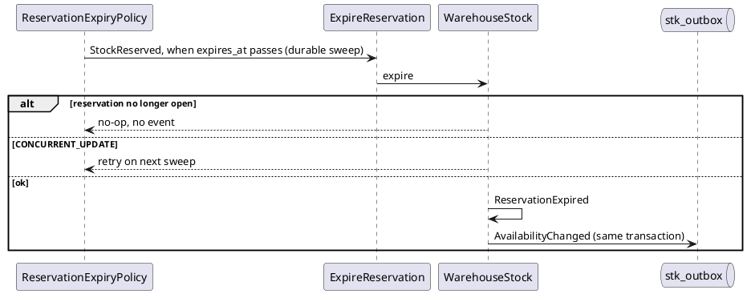

### FLOW-6 AvailabilityChanged to ReorderSuggestionRaised
Drawn from: 02-tactical-stock.md Domain events; 02-tactical-purchasing.md Commands, Domain events, Policies; 01 Context map (Stock to Purchasing).
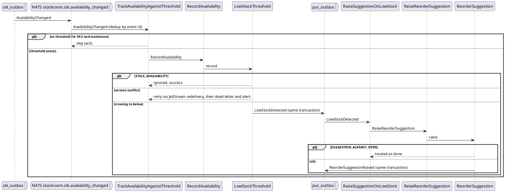

### FLOW-7 Accept or dismiss a suggestion
Drawn from: 02-tactical-purchasing.md Commands, Domain events. Behind REQ-15 and REQ-16, which are not core; shown because the decision events are published.
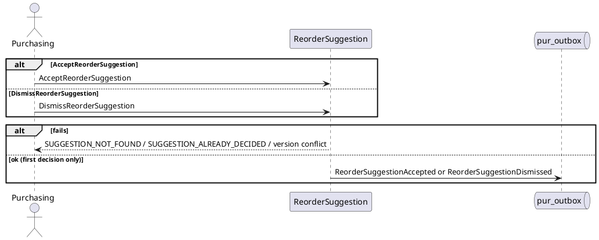

## Context map

### CTX-map
Drawn from: 01-strategic.md Context map.
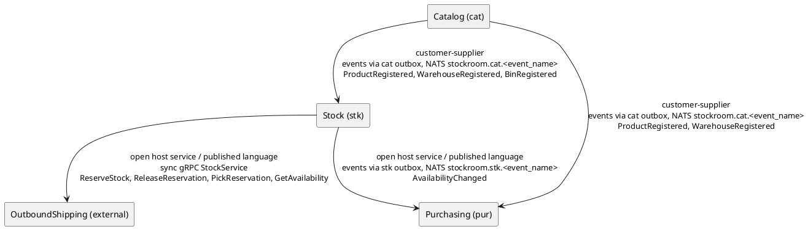
