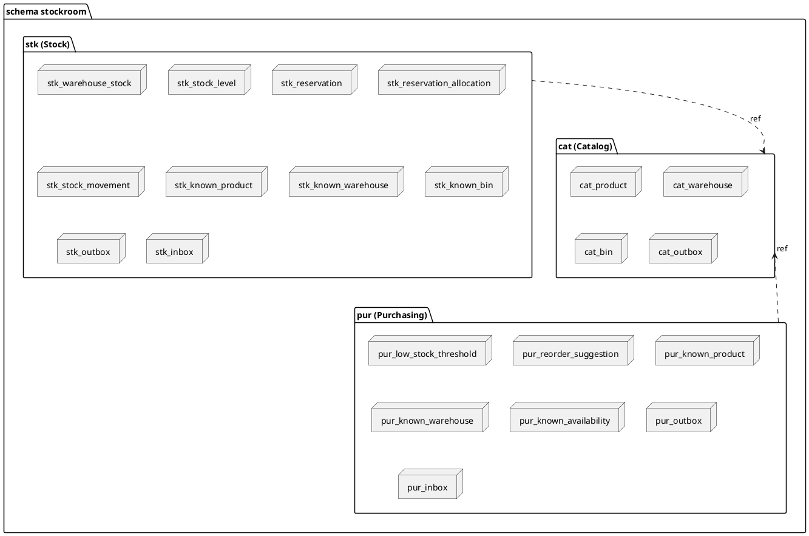
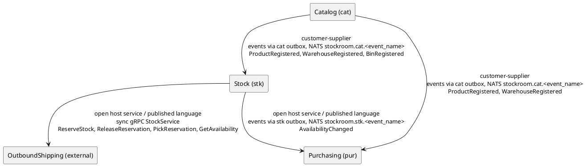

# 05 Diagrams

This is the index file. The use cases and the key flows are in two part files, because one file would be over 300 lines (DOC-01): [05-diagrams-use-cases.md](05-diagrams-use-cases.md) (UC-Catalog, UC-Stock, UC-Purchasing) and [05-diagrams-flows.md](05-diagrams-flows.md) (FLOW-1 to FLOW-7).

## Inputs
- project-profile.md: diagram_format = plantuml; architecture_style = microservices; events_messaging = outbox + NATS JetStream.
- 00-project-brief.md: Actors. Actor names follow the 02 triggers (WarehouseStaff, Purchasing, OutboundShipping, Reader).
- 01-strategic.md: Context map, Published language.
- 02-tactical-catalog.md, 02-tactical-stock.md, 02-tactical-purchasing.md: Commands, Domain events, Policies, Queries and read models.
- 03-db-design.md: Modules table. The `REF` lines of 03-db-design-stock.md and 03-db-design-purchasing.md give the cross-module references.

## Decisions
| Id | Decision | Why |
|---|---|---|
| D5-2 | The database overview draws one `ref` line per module pair (stk to cat, pur to cat), not one per column. | The overview is not the ERD; the columns are in 04. |
| D5-5 | Fixed F1 (DOC-01): the file was 321 lines, so use cases (D5-1, D5-4) and flows (D5-3) moved to the part files, each with its own Decisions. | Each file stays under 300 lines. |

Decisions D5-1 and D5-4 are in the use-cases file, D5-3 in the flows file.

## Open questions
Q5-1 and Q5-2 are in [05-diagrams-use-cases.md](05-diagrams-use-cases.md). Q5-3 is in [05-diagrams-flows.md](05-diagrams-flows.md). This file has none of its own.

## Use cases
See [05-diagrams-use-cases.md](05-diagrams-use-cases.md).

## Database modules

### DB-modules
Drawn from: 03-db-design.md Modules; REF lines of 03-db-design-stock.md and 03-db-design-purchasing.md. One shared schema `stockroom` (R1 overrides DB-02).

## Key flows
See [05-diagrams-flows.md](05-diagrams-flows.md).

## Context map

### CTX-map
Drawn from: 01-strategic.md Context map.

